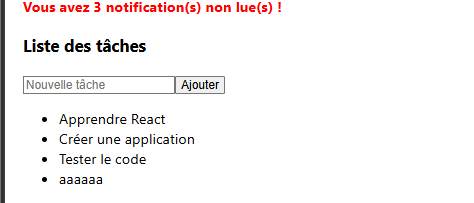
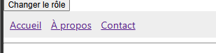
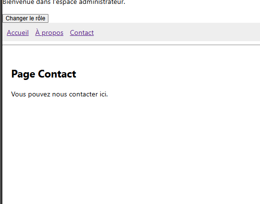

# TP 3 : Navigation, rendu conditionnel et intégration des ressources dans React

## 1. Présentation du projet

Ce projet a été réalisé dans le cadre des travaux pratiques React. Il permet de mettre en application les notions de composants, de gestion des états avec useState, de gestion des événements et de navigation avec React Router.

## 2. Technologies utilisées

React

JavaScript

JSX

React Router DOM

HTML et CSS

## 3. Structure du projet

Cette section présente la structure des fichiers et des composants de l'application React.

## 4. les rusultat de tout les etabe 

